# WI-IT-003
## วิธีปฏิบัติงานระบบ IT Hub

ศูนย์บริการเทคโนโลยีสารสนเทศ • คู่มือผู้ร้องขอ ผู้อนุมัติ และเจ้าหน้าที่ IT

| รายการควบคุมเอกสาร | รายละเอียด |
| --- | --- |
| รหัสเอกสารที่เสนอ | WI-IT-003 |
| ฉบับแก้ไข | 00 |
| วันที่จัดทำ / ตรวจระบบ | 28 ตุลาคม 2569 (2026-10-28) |
| เจ้าของกระบวนการ | ฝ่ายเทคโนโลยีสารสนเทศ |
| ผู้จัดทำ | |
| ผู้ทบทวน / ผู้อนุมัติ | |
| วันที่มีผลใช้ | ให้หน่วยงานกำหนดหลังอนุมัติเอกสาร |

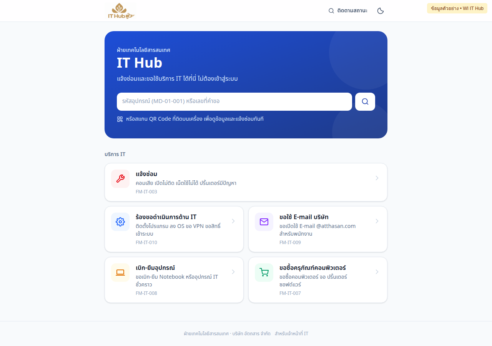

> ภาพประกอบจับจากหน้าเว็บ IT Hub ที่ใช้งานอยู่ โดยแทนข้อมูลบุคคล ใบงาน และ NAS ด้วยข้อมูลตัวอย่าง ตัวเลข ชื่อ และเลขที่ในภาพไม่ใช่หลักฐานรายการจริง คู่มือนี้ยังไม่มีการลงนามอนุมัติเป็นเอกสารควบคุมของหน่วยงาน

# 1. วัตถุประสงค์ ขอบเขต และหน้าที่

ใช้เป็นขั้นตอนมาตรฐานในการแจ้งซ่อม ขอรับบริการ IT ลงนามอนุมัติ รับเรื่อง ดำเนินการ ปิดงาน และค้นหลักฐาน รวมถึงทะเบียนอุปกรณ์ เอกสารฝ่าย IT และการจัดเก็บ PDF ของใบงานที่เสร็จสิ้นบน NAS

| ผู้รับผิดชอบ | หน้าที่ |
| --- | --- |
| ผู้ร้องขอ / ผู้ยืม | เลือกบริการ กรอกข้อมูล ลงนามเมื่อแบบฟอร์มกำหนด เก็บเลขที่คำขอ และติดตามผล |
| หัวหน้าฝ่าย / ผู้อนุมัติต้นสังกัด | ตรวจคำขอจากลิงก์อีเมล ลงนามอนุมัติหรือไม่อนุมัติ |
| ผู้รับรองผล FM-IT-010 | ตรวจผลดำเนินการล่าสุดและลงนามรับรองก่อน IT ปิดงาน |
| เจ้าหน้าที่ IT (Admin) | รับเรื่อง อนุมัติเบิก–ยืม จัดการอุปกรณ์ เอกสาร ผู้ลงนาม และติดตามผลส่ง NAS |
| ผู้ลงนามเอกสารจัดซื้อ | ลงนามในตำแหน่งที่ IT ส่งขอ โดยไม่เปลี่ยนสถานะงาน IT อัตโนมัติ |

1. ผู้ร้องขอเข้าหน้าเว็บได้โดยไม่ต้องเข้าสู่ระบบ ส่วน Admin ใช้บัญชี IT Hub ที่ได้รับมอบหมาย ซึ่งแยกจาก ERP
2. เตรียมข้อมูลปัญหา/วัตถุประสงค์ แผนก ช่องทางติดต่อ และรหัสอุปกรณ์ถ้ามี ผู้อนุมัติต้องอยู่ในรายชื่อที่เปิดใช้งานและมีอีเมล
3. ใช้อุปกรณ์ที่เปิดเว็บไซต์ HTTPS ได้ หากใช้ QR ให้เตรียมกล้องโทรศัพท์และเครือข่ายที่เข้าถึงระบบ
4. เมนู เอกสาร และข้อความใน WI อ้างอิงผลตรวจวันที่จัดทำ ให้ตรวจคู่มือใหม่เมื่อขั้นตอนระบบเปลี่ยน

> เกณฑ์สำเร็จ: ผู้ร้องขอมีเลขที่คำขอ เจ้าหน้าที่มีผลดำเนินการและหลักฐานตามแบบฟอร์ม และตรวจสถานะการส่ง NAS แยกจากสถานะเสร็จสิ้นของงาน

# 2. เลือกบริการและเข้าใจกระบวนการ

| บริการ | แบบฟอร์ม / เลขที่ | ขั้นตอนสำคัญ |
| --- | --- | --- |
| แจ้งซ่อม | FM-IT-003 / RP | ระบุอาการ → IT ดำเนินการ → บันทึกผลและปิดงาน |
| ร้องขอดำเนินการด้าน IT | FM-IT-010 / SV | ผู้ร้องขอลงนาม → หัวหน้าฝ่ายอนุมัติ → IT ดำเนินการ → ผอ./ผจก. รับรองผลล่าสุด → IT ปิดงาน |
| ขอใช้ E-mail บริษัท | FM-IT-009 / EM | กรอกข้อมูลบัญชีและบริษัท → IT ดำเนินการ → ปิดงาน |
| เบิก–ยืมอุปกรณ์ | FM-IT-008 / BR | ส่งคำขอ → Admin อนุมัติ → สร้างบันทึกอัตโนมัติ → จ่าย/คืนแยกรายการ |
| ขอซื้อครุภัณฑ์คอมพิวเตอร์ | FM-IT-007 / PR | ผู้ร้องขอลงนาม → ต้นสังกัดอนุมัติ → IT ดำเนินการ; ส่งขอลายเซ็นจัดซื้อเพิ่มเติมได้ |

รูปแบบเลขที่คำขอ: คำนำหน้า 2 ตัว–ปี/เดือน 4 หลัก–ลำดับ 4 หลัก เช่น SV-2610-9001 ในภาพตัวอย่าง

ลำดับสถานะที่ใช้ทั่วไป: รอรับเรื่อง → รับเรื่องแล้ว → กำลังดำเนินการ → เสร็จสิ้น โดยใช้สถานะรอเพิ่มเติมเมื่อรอข้อมูล/อุปกรณ์ และใช้ไม่อนุมัติหรือยกเลิกตามข้อเท็จจริง ระบบไม่ได้บังคับให้ทุกงานผ่านทุกสถานะ

> การส่ง PDF ไป NAS เกิดจากการปิดใบงานคำขอ ไม่ใช่การบันทึกเอกสารฝ่าย IT ทุกฉบับโดยอัตโนมัติ ทะเบียน FM-IT-008 ที่เชื่อมกับใบงานเบิก–ยืมใช้ประกอบ PDF ของใบงานนั้น

# 3. เปิดระบบ ค้นหา และสแกน QR

1. เปิด https://abms.ddns.net:8445/it-hub/ จากคอมพิวเตอร์หรือโทรศัพท์
2. เลือกการ์ดบริการที่ตรงกับงาน หรือกรอกรหัสอุปกรณ์/เลขที่คำขอในช่องค้นหา แล้วกดไอคอนค้นหา
3. เมื่อสแกน QR บนอุปกรณ์ ระบบเปิดข้อมูลอุปกรณ์ ให้ตรวจรหัส รุ่น หน่วยงาน และสถานที่ก่อนแจ้งซ่อม
4. กดแจ้งซ่อมจากหน้าอุปกรณ์ ระบบนำรหัสอุปกรณ์ไปยังแบบแจ้งซ่อม; บริการประเภทอื่นไม่ผูกข้อมูลอุปกรณ์จาก QR
5. หากไม่พบรหัส ให้ตรวจตัวอักษรบนสติกเกอร์และแจ้ง IT หากไม่ทราบรหัส สามารถเปิดแบบแจ้งซ่อมจากหน้าแรกได้

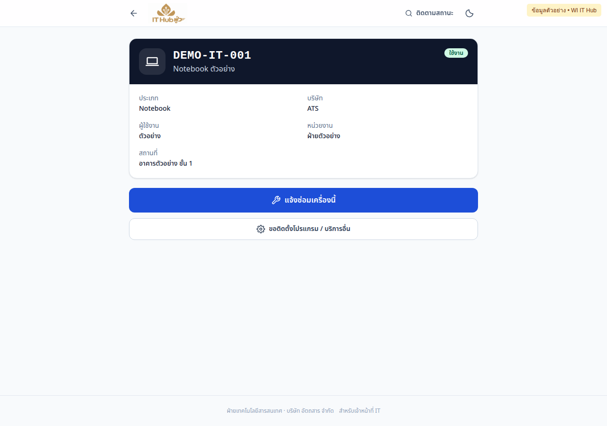

> หน้าสาธารณะเปิดเผยข้อมูลอุปกรณ์บางส่วน ส่วน Serial ชื่อผู้ถือครองเต็มและหมายเหตุภายในอยู่ในหน้า Admin

# 4. แจ้งซ่อม FM-IT-003

1. จากหน้าแรกเลือกแจ้งซ่อม หรือเปิดจาก QR ของเครื่องที่มีปัญหา
2. เลือกประเภทงาน กรอกอุปกรณ์ที่เสีย รหัสอุปกรณ์ถ้ามี อาการ และเหตุการณ์ก่อนพบปัญหาให้ชัดเจน
3. ระบุวันเวลาที่พบและสถานที่ แนบรูปปัญหาได้ โดยตรวจว่ารูปไม่มีข้อมูลที่ไม่เกี่ยวข้อง
4. กรอกชื่อ–นามสกุลและฝ่าย/แผนก พร้อมเบอร์โทรหรืออีเมลที่ติดต่อได้
5. ตรวจข้อมูลแล้วกดส่งคำขอ รอหน้าสำเร็จและเก็บเลขที่ขึ้นต้น RP

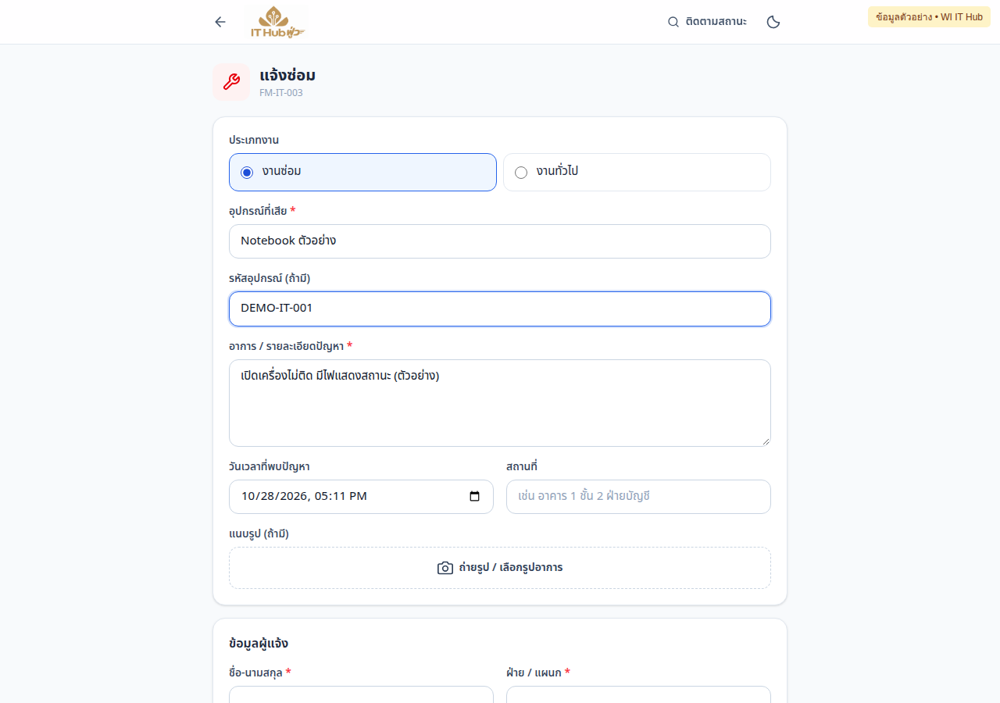

ผลที่ต้องได้: ได้เลขที่คำขอหนึ่งรายการ และเปิดติดตามสถานะได้ หากระบบแจ้งข้อมูลไม่ครบ ให้แก้ช่องที่ระบุแล้วส่งใหม่

# 5. เก็บเลขที่หลังส่งคำขอ

1. ตรวจว่าหน้าจอแจ้งบันทึกสำเร็จและแสดงเลขที่คำขอ
2. กดคัดลอกหรือบันทึกภาพเลขที่ไว้ เพื่อใช้ติดต่อ IT และติดตามงานจากอุปกรณ์อื่น
3. เปิดหน้าติดตามจากปุ่มที่แสดง แล้วตรวจประเภทคำขอและสถานะ
4. ถ้าระบบแจ้งว่าส่งอีเมลขออนุมัติไม่สำเร็จ แต่มีเลขที่คำขอแล้ว ให้แจ้ง IT พร้อมเลขที่เดิมเพื่อส่งอีเมลใหม่
5. เมื่อเครือข่ายขัดข้องหลังส่ง ให้ตรวจรายการล่าสุดจากเครื่องนี้หรือสอบถาม IT ก่อนส่งคำขอซ้ำ

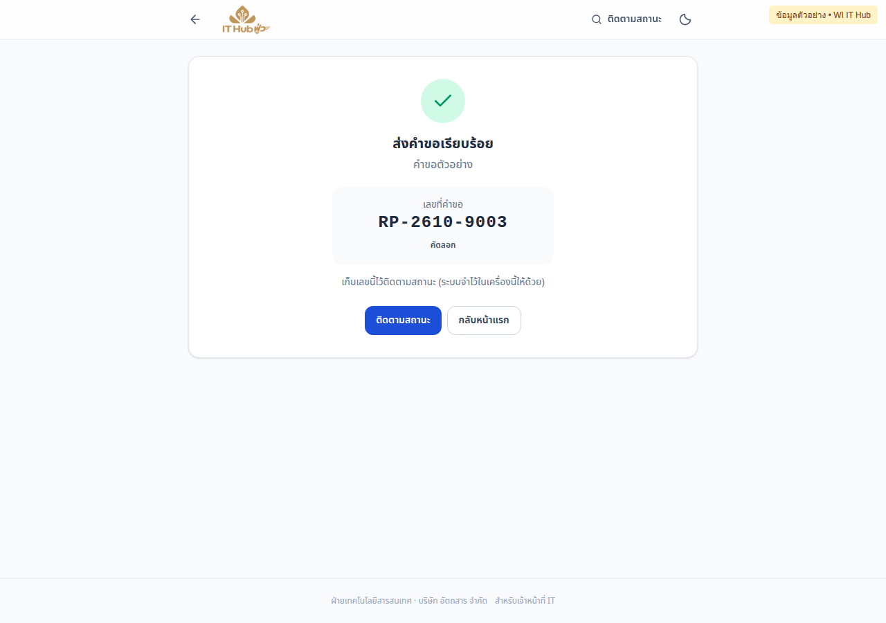

> ประวัติจากเครื่องนี้เก็บในเบราว์เซอร์ การเปลี่ยนเครื่อง ล้างข้อมูล หรือใช้โหมดส่วนตัวอาจไม่เห็นรายการเดิม จึงควรเก็บเลขที่แยกไว้

# 6. ร้องขอดำเนินการด้าน IT FM-IT-010

1. เลือกร้องขอดำเนินการด้าน IT ระบุอุปกรณ์และสิ่งที่ต้องการ เช่น ติดตั้งโปรแกรม ขอ VPN ขอสิทธิ์ หรือขอ E-mail บริษัท
2. เลือกรายการที่เกี่ยวข้องและระบุ OS/โปรแกรม รายละเอียด และวัตถุประสงค์
3. กรอกข้อมูลผู้ร้องขอ แผนก ตำแหน่ง และช่องทางติดต่อ
4. เลือกหัวหน้าฝ่าย/ผู้อนุมัติที่รับผิดชอบจากรายชื่อ หากไม่พบ ให้แจ้ง IT ตรวจข้อมูลพนักงานและอีเมล
5. เลื่อนลงไปลงนามผู้ร้องขอตามข้อ 7 ก่อนส่งคำขอ

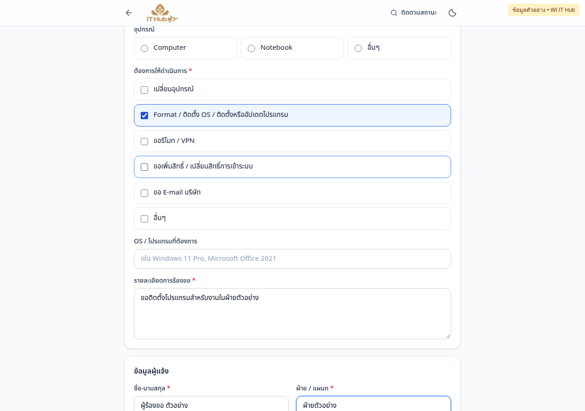

ผลที่ต้องได้: เลขที่ SV และสถานะรออนุมัติ เจ้าหน้าที่ IT เริ่มงานได้เมื่อหัวหน้าฝ่ายลงนามอนุมัติแล้ว

# 7. ลงนามผู้ร้องขอ FM-IT-010 และ FM-IT-007

1. ตรวจชื่อผู้ร้องขอ ซึ่งอ้างอิงจากชื่อในส่วนข้อมูลผู้แจ้ง
2. วาดลายเซ็นของตนเองในกรอบด้วยเมาส์ นิ้ว หรือปากกาบนจอ ถ้าผิดให้ล้างแล้ววาดใหม่
3. ตรวจช่องบังคับ เลือกผู้อนุมัติให้ถูกต้อง แล้วกดส่งคำขอ
4. ระบบบันทึกชื่อ ภาพลายเซ็น และวันเวลาจากเซิร์ฟเวอร์ไว้กับคำขอและฉบับพิมพ์
5. บนอุปกรณ์ส่วนกลาง ให้พิจารณาปิดตัวเลือกจำข้อมูลผู้แจ้ง และตรวจข้อมูลที่กรอกให้อัตโนมัติก่อนทุกครั้ง

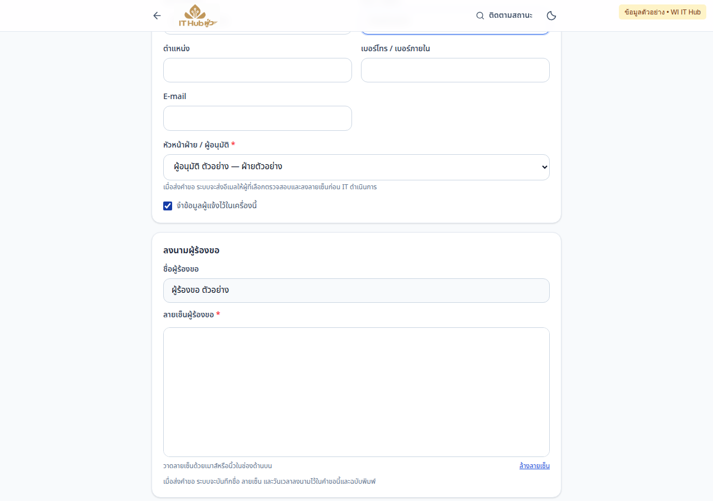

> ระบบไม่จำภาพลายเซ็นผู้ร้องขอไว้ในเครื่อง คำขอเก่าที่ไม่มีภาพลงนามจะไม่ถูกเติมภาพให้ย้อนหลัง

# 8. ขอใช้ E-mail บริษัท FM-IT-009

1. เลือกขอใช้ E-mail บริษัทจากหน้าแรก
2. กรอกชื่อ–นามสกุลภาษาไทยและอังกฤษ ตำแหน่ง และเลือกบริษัทให้ตรงกับผู้ใช้งาน
3. ระบุชื่อ E-mail ที่ต้องการ หรือใช้ชื่อที่ระบบแนะนำเป็นข้อมูลเสนอให้ IT ตรวจสอบ
4. กรอกรายละเอียด/วัตถุประสงค์ และข้อมูลผู้แจ้งกับฝ่าย/แผนกให้ครบ
5. ส่งคำขอและเก็บเลขที่ EM ติดตามการดำเนินการและประสาน IT เพื่อรับข้อมูลเข้าใช้งานตามช่องทางที่หน่วยงานกำหนด

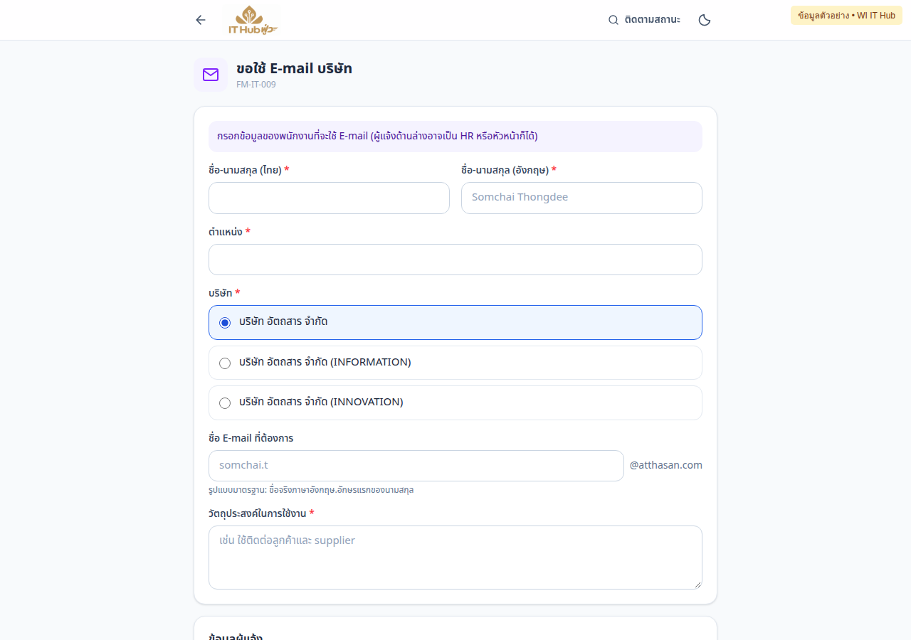

> ชื่อผู้อนุมัติที่พิมพ์ในแบบนี้ไม่เท่ากับขั้นลงนามออนไลน์ของ FM-IT-010 ห้ามใส่รหัสผ่านชั่วคราวในรายละเอียดหรือผลดำเนินการที่ผู้แจ้งเปิดดูได้

# 9. ขอเบิก–ยืมอุปกรณ์ FM-IT-008

1. เลือกเบิก–ยืมอุปกรณ์ ระบุประเภท ชื่ออุปกรณ์ และจำนวนในแต่ละรายการ
2. กดเพิ่มรายการอุปกรณ์เมื่อขอหลายชนิด ลบแถวที่ไม่ใช้ก่อนส่ง รองรับ 1–50 รายการ จำนวนต่อรายการ 1–100
3. ระบุวันที่เริ่มใช้ วันที่คืนถ้าทราบ และวัตถุประสงค์ ช่วงวันดังกล่าวใช้ร่วมกันทั้งคำขอ
4. กรอกชื่อผู้ยืม แผนก และช่องทางติดต่อ จากนั้นส่งและเก็บเลขที่ BR
5. รอ Admin IT Hub ตรวจและอนุมัติ การส่งคำขอเพียงอย่างเดียวยังไม่สร้างทะเบียนจ่าย/คืน

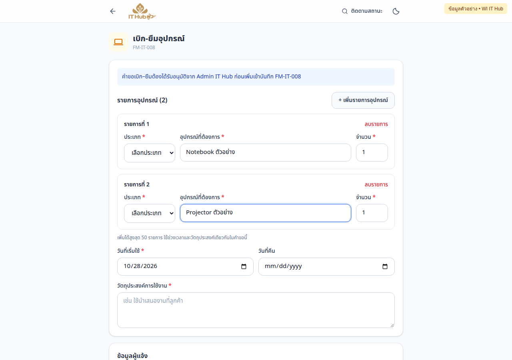

ผลที่ต้องได้: คำขออยู่ในรายการรออนุมัติ หลังอนุมัติระบบสร้างบันทึก FM-IT-008 หนึ่งฉบับที่มีทุกรายการ ผู้ยืมรับและคืนอุปกรณ์ตามการนัดหมายของ IT

# 10. ขอซื้อครุภัณฑ์คอมพิวเตอร์ FM-IT-007

1. เลือกขอซื้อครุภัณฑ์คอมพิวเตอร์ ระบุความเร่งด่วนและวันที่ต้องการ
2. เลือกประเภทอุปกรณ์ กรอกวัตถุประสงค์และรายละเอียดสเปก เช่น CPU, RAM และพื้นที่จัดเก็บ
3. กรอกข้อมูลผู้ร้องขอ เลือกผู้มีอำนาจอนุมัติต้นสังกัด และวาดลายเซ็นผู้ร้องขอ
4. ส่งคำขอและเก็บเลขที่ PR ต้นสังกัดต้องลงนามก่อน IT รับเรื่องหรือดำเนินการ
5. หลังรับเรื่อง IT บันทึกข้อมูลผู้ขาย ใบเสนอราคา ยอดเงิน VAT และส่งขอลายเซ็นจัดซื้อเพิ่มเติมตามที่ใช้จริง

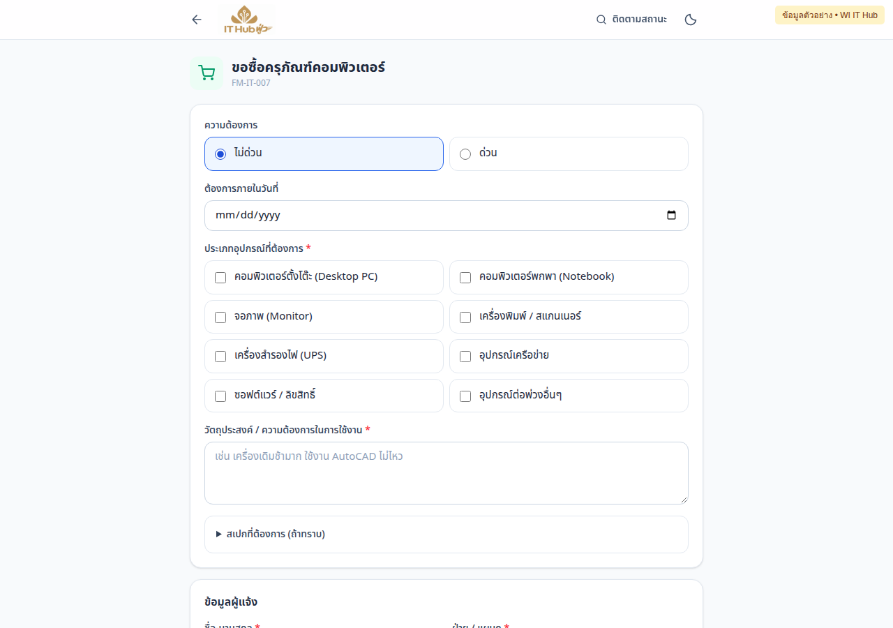

> ผู้รับเรื่องอ้างอิง Admin ที่ทำรายการจริง ลายเซ็นอีก 3 ตำแหน่งส่งขอแยกได้และลงนามหลัง IT ปิดงานได้ โดยไม่บังคับรอครบเพื่อปิดงาน ส่วน FM-IT-010 ยังต้องรับรองผลก่อนปิดตามข้อ 15

# 11. ติดตามสถานะคำขอ

1. กรอกเลขที่คำขอที่หน้าแรก หรือเปิดเมนูติดตามสถานะแล้วกรอกเลขที่
2. ตรวจเลขที่ ประเภท หัวข้อ สถานะงาน และผลอนุมัติถ้ามี
3. อ่านผลการดำเนินการและประวัติที่เปิดให้ผู้แจ้งเห็น
4. หากรออนุมัตินาน ข้อมูลไม่ตรง หรือมีข้อสงสัย ให้ติดต่อ IT พร้อมเลขที่คำขอ
5. การติดตามจากอุปกรณ์อื่นใช้เลขที่เดิมได้ ไม่จำเป็นต้องสร้างคำขอใหม่

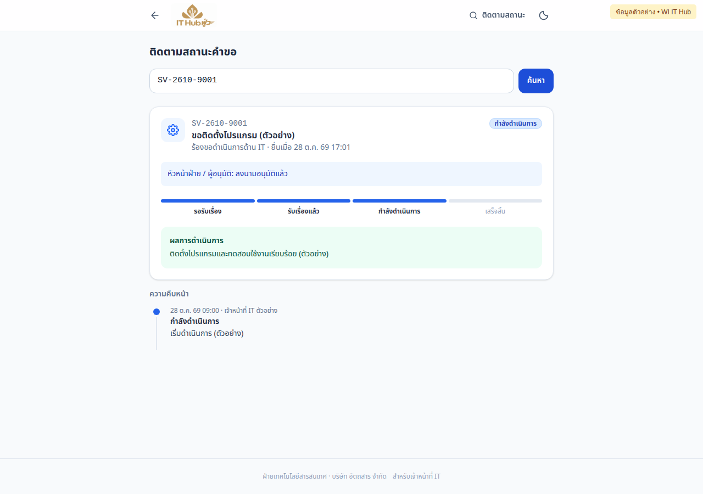

> หน้านี้ไม่แสดงข้อมูลผู้ร้องขอ ลายเซ็น และบันทึกที่ตั้งเป็นภายใน เจ้าหน้าที่ต้องระวังข้อมูลที่บันทึกในช่องผลดำเนินการ เพราะผู้แจ้งอ่านได้

# 12. อนุมัติคำขอจากอีเมล

1. ผู้อนุมัติเปิดลิงก์จากอีเมลที่ระบบส่งให้ตน ตรวจเลขที่ ผู้ร้องขอ รายละเอียด และบทบาทที่ต้องลงนาม
2. เลือกผลอนุมัติหรือไม่อนุมัติ หากไม่อนุมัติต้องระบุเหตุผล
3. เลือกใช้ลายเซ็นของตนที่มีใน E-Procurement เมื่อระบบแสดงตัวเลือก หรือวาดลายเซ็นใหม่
4. ทำเครื่องหมายยืนยันการตรวจสอบและยินยอมลงนาม จากนั้นกดยืนยัน
5. รอข้อความบันทึกการลงนามสำเร็จ การเปิดลิงก์หรือเห็นภาพลายเซ็นอย่างเดียวยังไม่ถือว่าอนุมัติ

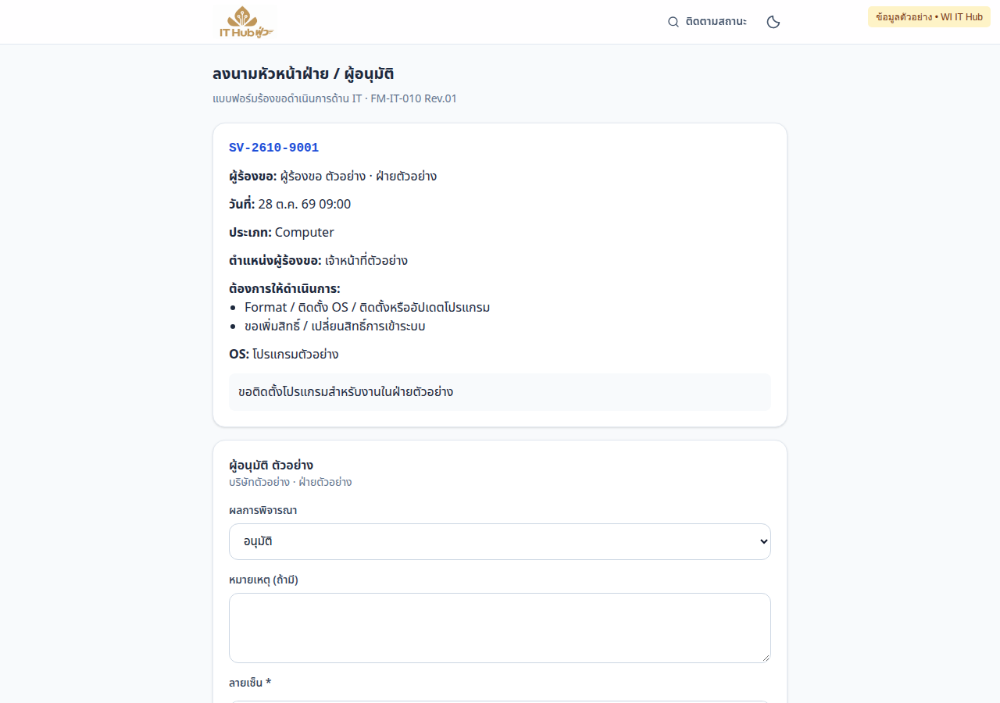

> ลิงก์ลงนามมีอายุ 7 วัน ใช้ลงนามได้ครั้งเดียว การส่งใหม่ยกเลิกลิงก์เก่า หากลิงก์หมดอายุหรือใช้ไม่ได้ ให้ IT ตรวจและส่งใหม่ ห้ามส่งลิงก์ส่วนตัวต่อให้ผู้อื่น

# 13. รับรองผลการดำเนินการ FM-IT-010

1. ผู้รับรองผลเปิดอีเมลขอลงนามหลัง IT บันทึกผลดำเนินการแล้ว
2. ตรวจบทบาทว่าเป็นการรับรองผลก่อนปิดงาน และอ่านผลดำเนินการที่แสดงในเอกสาร
3. เลือกรับรองผล หรือไม่รับรองพร้อมเหตุผล ลงนามและยืนยันความยินยอม
4. เมื่อรับรองแล้ว ให้ IT ตรวจสถานะลายเซ็นและกดปิดงานเป็นเสร็จสิ้นในระบบ
5. หากไม่รับรอง IT ต้องแก้ไขงาน/ผล แล้วส่งขอรับรองรอบใหม่ ประวัติรอบเดิมยังเก็บไว้

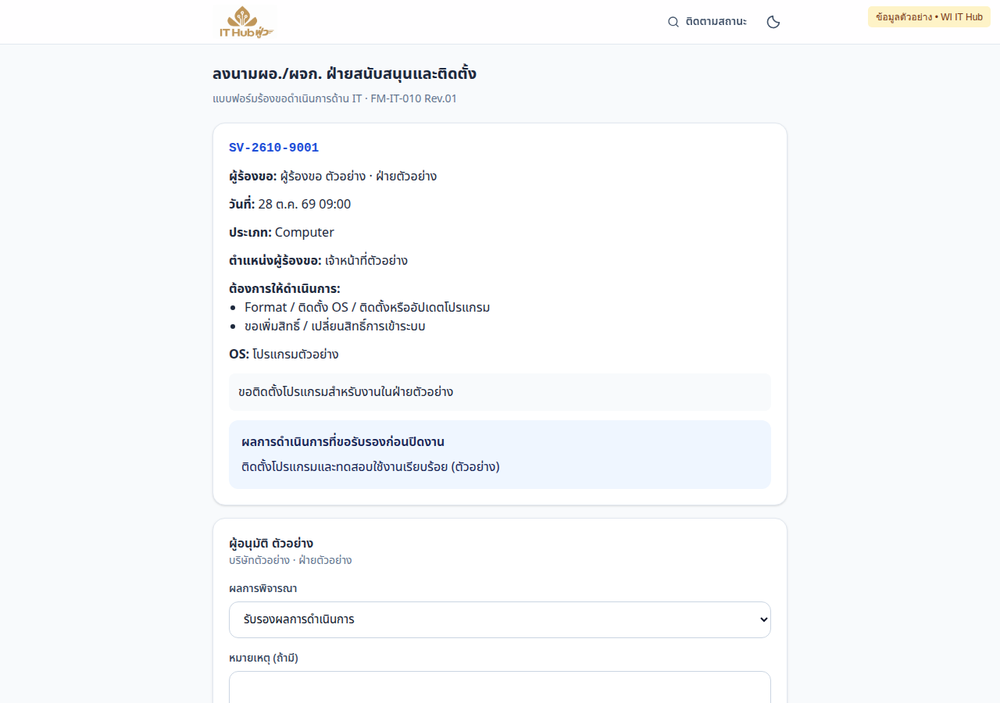

> การรับรองผลไม่ปิดงานให้อัตโนมัติ ถ้าผลดำเนินการเปลี่ยนหรือเปิดงานใหม่ ต้องรับรองผลฉบับปัจจุบันอีกครั้งก่อนปิดงาน ไม่ใช้ผลอนุมัติหัวหน้าฝ่ายแทนการรับรองผล

# 14. เข้าสู่ระบบ Admin และรับเรื่อง

1. เปิด https://abms.ddns.net:8445/it-hub/admin และเข้าสู่ระบบด้วยบัญชี IT Hub ของตน
2. ตรวจหน้า ภาพรวม เพื่อดูงานค้าง งานตามประเภท และคิวที่ต้องดำเนินการ
3. เปิด คำขอ / แจ้งซ่อม ค้นเลขที่หรือกรองประเภท สถานะ ผู้รับผิดชอบ และช่วงวันที่
4. เปิดใบงาน ตรวจรายละเอียด ผลอนุมัติ และไฟล์แนบก่อนรับเรื่อง
5. กำหนดผู้รับผิดชอบและความสำคัญให้ตรงกับงานที่ได้รับมอบหมาย ใช้เมนูออกจากระบบเมื่อเลิกใช้งาน

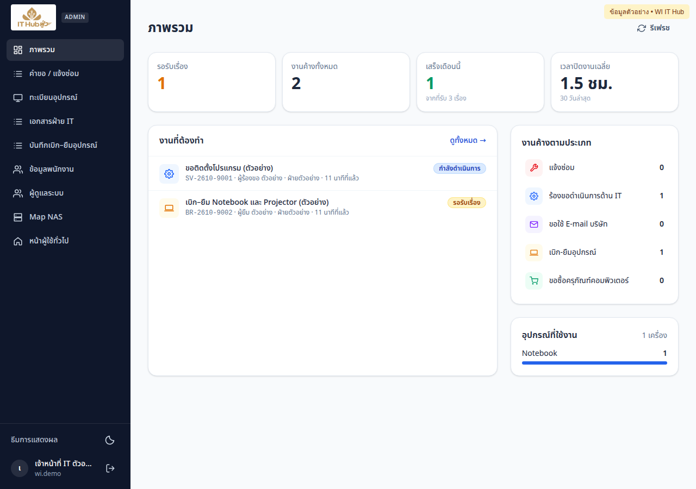

> การเข้าสู่ระบบผิดครบ 5 ครั้งภายใน 15 นาทีจะถูกจำกัดการลองเข้าสู่ระบบ ให้ตรวจบัญชีก่อนลองใหม่ ไม่ใช้บัญชีร่วมกันเพื่อให้ผู้ทำรายการตรวจสอบย้อนหลังได้

# 15. บันทึกผล ลงนาม IT และปิดงาน

1. เปิดใบงานแล้วตรวจเงื่อนไขอนุมัติ: SV/PR ที่มีขั้นอนุมัติต้องได้รับอนุมัติต้นสังกัดก่อน ส่วน BR ต้องผ่าน Admin อนุมัติเบิก–ยืม
2. รับเรื่อง/เริ่มงาน บันทึกผลการดำเนินการ ผู้รับผิดชอบ วิธีแก้ไข และข้อมูลอื่นตามประเภทงาน กดบันทึกเมื่อเปลี่ยนข้อมูล
3. ลงนามในบทบาทเจ้าหน้าที่ IT ด้วยบัญชีผู้ทำรายการจริง โดยตั้งค่าภาพลายเซ็นของตนในเมนูผู้ดูแลระบบก่อนถ้ายังไม่มี
4. สำหรับ FM-IT-010 เลือกผู้รับรองผล กดบันทึกผลและขอลายเซ็น ผอ./ผจก. แล้วตรวจสถานะลายเซ็นให้เป็นการรับรองผลล่าสุด
5. กดปิดงานเป็นเสร็จสิ้นหลังดำเนินการครบ ตรวจผลที่ผู้แจ้งเห็นและสถานะคิว NAS

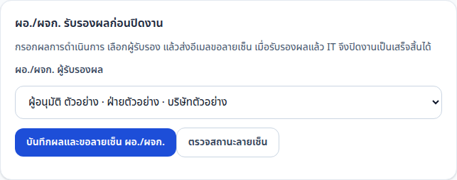

> ใบซ่อมที่ผูกอุปกรณ์ เมื่อปิดเสร็จสิ้นระบบบันทึกประวัติ BM ให้อัตโนมัติ เลือกบันทึกภายในสำหรับหมายเหตุที่ไม่ควรเปิดให้ผู้แจ้งอ่าน และไม่ใส่รหัสผ่านในผลดำเนินการ

# 16. Admin อนุมัติเบิก–ยืม

1. เปิด บันทึกเบิก–ยืมอุปกรณ์ แล้วตรวจตารางคำขอรอ Admin IT Hub อนุมัติ
2. กดตรวจสอบ / อนุมัติ เพื่อเปิดใบงาน ทบทวนผู้ยืม วัตถุประสงค์ ช่วงวันที่ ทุกรายการ และจำนวน
3. ตรวจความพร้อมของอุปกรณ์ แล้วกดอนุมัติและเพิ่มเข้าบันทึก FM-IT-008
4. ระบบบันทึกผู้อนุมัติ วันเวลา และสร้างบันทึกที่เชื่อมกับคำขอหนึ่งฉบับอัตโนมัติ กดเปิดบันทึก / พิมพ์ FM-IT-008 เพื่อบันทึกการจ่าย
5. หากไม่อนุมัติ ให้ใส่เหตุผลก่อนกดไม่อนุมัติการเบิก–ยืม คำขอจะไม่เข้าบันทึก

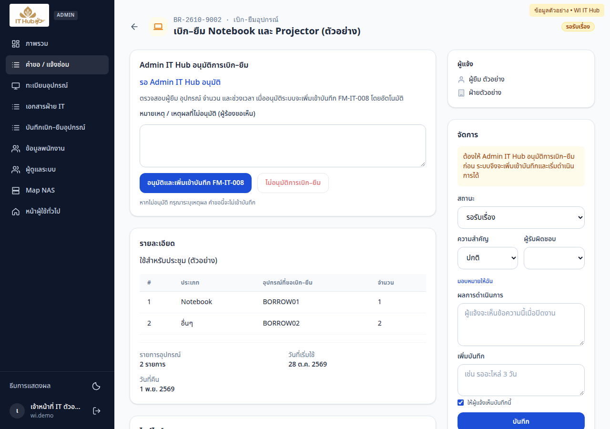

> ไม่สร้างทะเบียน FM-IT-008 โดยตรงเพื่อข้ามขั้นอนุมัติ คำขอเดียวเก็บหลายรายการร่วมกันได้ และตรวจผลอนุมัติจากเลขที่ BR ได้

# 17. จ่ายอุปกรณ์และบันทึกคืนแยกรายการ

1. เปิดบันทึก FM-IT-008 ที่สร้างจากคำขออนุมัติแล้ว ตรวจคำขอต้นทางและผู้อนุมัติ
2. เติม Serial และข้อมูลการจ่าย/เจ้าหน้าที่ตามช่องที่เปิดให้แก้ไข โดยคงผู้ยืม รายการ จำนวน และช่วงวันจากคำขอที่อนุมัติ
3. เมื่อรับคืน ให้เปิดรายการนั้น ระบุวันที่คืน ผู้คืน ผู้รับคืน และสภาพอุปกรณ์
4. วันที่คืนต้องไม่ก่อนวันที่ใช้งาน สามารถคืนบางรายการก่อนและบันทึกรายการที่เหลือภายหลัง
5. กดบันทึกข้อมูล ตรวจจำนวนยืมอยู่/คืนแล้ว และกดพิมพ์เอกสารเพื่อพิมพ์ FM-IT-008 A4 แนวนอน

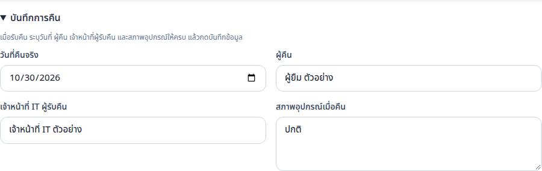

ผลที่ต้องได้: มี Serial และข้อมูลคืนตามอุปกรณ์จริง จำนวนรายการที่ยังยืมอยู่ลดลงตามการคืน ชื่อเจ้าหน้าที่ที่กรอกเป็นข้อมูลบันทึก ไม่ได้ดึงภาพลายเซ็นของผู้อื่นมาใส่อัตโนมัติ

# 18. ใช้เอกสารฝ่าย IT และพิมพ์แบบเปล่า

1. เปิด เอกสารฝ่าย IT เลือกแบบฟอร์มให้ตรงกับงาน
2. กดพิมพ์แบบฟอร์มเปล่าหากต้องการใช้กระดาษ หรือกดสร้างเอกสารเพื่อบันทึกในระบบ
3. ตรวจข้อมูล วันที่ บริษัท และแถวรายการให้ครบ กดบันทึกฉบับร่างก่อนส่งลงนามหรือพิมพ์
4. เอกสารที่มีผู้ลงนามให้เลือกผู้รับผิดชอบตามตำแหน่งแล้วส่ง ระบบดำเนินการตามลำดับของแบบฟอร์มนั้น
5. หลังลงนามคำขอครบ กรอกผลและส่งขอรับรองตามขั้นตอนที่หน้าจอแสดง ตรวจประวัติและสถานะก่อนใช้เป็นหลักฐาน

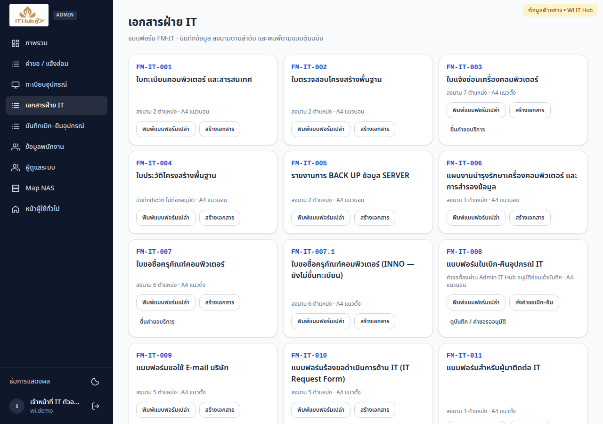

> งานคำขอสาธารณะกับเอกสารที่สร้างในเมนูนี้เป็นคนละรายการ ให้เลือกช่องทางเดียวกับกระบวนการที่หน่วยงานใช้ เมื่อต้องการเบิก–ยืม ระบบพาไปยื่นคำขอเพื่อรอ Admin อนุมัติก่อน

# 19. รายการแบบฟอร์มและสถานะเอกสาร

| รหัส | ชื่อ / การใช้งาน |
| --- | --- |
| FM-IT-001 | ใบทะเบียนคอมพิวเตอร์และสารสนเทศ |
| FM-IT-002 | ใบตรวจสอบโครงสร้างพื้นฐาน |
| FM-IT-003 | ใบแจ้งซ่อมเครื่องคอมพิวเตอร์ |
| FM-IT-004 | ใบประวัติโครงสร้างพื้นฐาน / บำรุงรักษา |
| FM-IT-005 | รายงานการ BACK UP ข้อมูล SERVER |
| FM-IT-006 | แผนงานบำรุงรักษาเครื่องคอมพิวเตอร์และการสำรองข้อมูล |
| FM-IT-007 | ใบขอซื้อครุภัณฑ์คอมพิวเตอร์ |
| FM-IT-007.1 | ฉบับ INNO ที่ระบบระบุว่ายังไม่ขึ้นทะเบียน ต้องตรวจสถานะเอกสารกับหน่วยงานก่อนใช้ |
| FM-IT-008 | แบบฟอร์มใบเบิก–คืนอุปกรณ์ IT ใช้เป็นบันทึกหลังอนุมัติ |
| FM-IT-009 | แบบฟอร์มขอใช้ E-mail บริษัท |
| FM-IT-010 | แบบฟอร์มร้องขอดำเนินการด้าน IT |
| FM-IT-011 | แบบฟอร์มสำหรับผู้มาติดต่อ IT |

สถานะเอกสารทั่วไป: ฉบับร่าง → รอลงนามคำขอ (ถ้ามี) → ดำเนินการ / บันทึกผล → รอลงนามรับรอง → รับรองครบแล้ว โดยมีไม่อนุมัติ / ไม่รับรอง และยกเลิกตามผลจริง เอกสารที่ไม่มีบทบาทลงนามใช้เพื่อบันทึกประวัติ ส่วน FM-IT-008 แสดงบันทึกแล้วและจำนวนยืม/คืน

> ผู้ลงนาม Admin ลงนามได้เมื่อถึงลำดับของตนและยืนยันความยินยอม ผู้ลงนามผ่านอีเมลใช้ลิงก์เฉพาะบุคคล หากแก้ฉบับที่ล็อกแล้วให้ใช้ขั้นตอนฉบับใหม่ตามที่ระบบอนุญาต ไม่คัดลอกชื่อมาแทนลายเซ็น

# 20. ทะเบียนอุปกรณ์และประวัติบำรุงรักษา

1. เปิด ทะเบียนอุปกรณ์ ค้นรหัส Serial รุ่น หรือผู้ถือครอง และกรองบริษัท หมวด และสถานะ
2. เปิดรายการเพื่อตรวจข้อมูลอุปกรณ์ วันประกัน ผู้ถือครอง และงานซ่อมที่เกี่ยวข้อง
3. เมื่อต้องเพิ่ม/แก้ไข ให้ตรวจรหัสไม่ซ้ำและข้อมูลให้ตรงอุปกรณ์จริง แล้วกดบันทึก
4. บันทึก PM หรือประวัติอื่นพร้อมวันที่ รายละเอียด ระยะเวลา และผู้รับผิดชอบ ส่วน BM จากงานซ่อมที่ผูกอุปกรณ์เกิดเมื่อปิดงานเสร็จสิ้น
5. ตรวจผลจากหน้ารายละเอียด และเปิด QR สาธารณะเพื่อตรวจข้อมูลที่จะให้ผู้ใช้เห็น

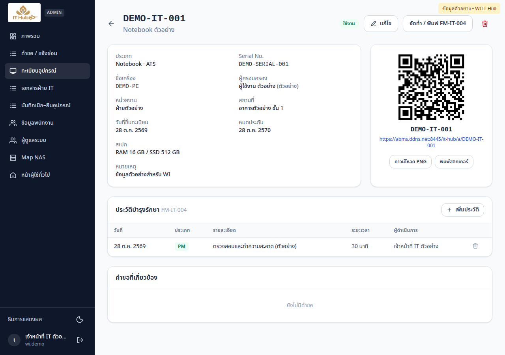

> สถานะอุปกรณ์มีใช้งาน ส่งซ่อม สำรอง และเลิกใช้งาน ให้เลือกตามข้อเท็จจริง การลบหรือปรับทะเบียนควรตรวจประวัติที่เกี่ยวข้องก่อนทำรายการ

# 21. พิมพ์สติกเกอร์ QR และแบบฟอร์ม

1. จากทะเบียนอุปกรณ์ เลือกเครื่องที่ต้องการพิมพ์แล้วเปิดหน้าพิมพ์ QR
2. เลือกม้วนสติกเกอร์สำหรับ 50 × 40 มม. หน้าละ 1 ดวง หรือ A4 ซึ่งจัดได้ 3 × 6 ดวงต่อหน้า
3. กดพิมพ์ ตั้งค่ากระดาษตามที่เลือก ใช้มาตราส่วนจริง 100% และปิดหัว/ท้ายกระดาษที่เบราว์เซอร์เพิ่ม
4. พิมพ์ทดสอบ 1 ดวง ตรวจรหัส ความคมชัด แนวข้อความ และสแกนด้วยโทรศัพท์บนเครือข่ายใช้งานจริงก่อนพิมพ์ทั้งชุด
5. แบบฟอร์มใบงานใช้ปุ่มพิมพ์ฟอร์ม ส่วนเอกสารฝ่าย IT ใช้พิมพ์เอกสาร ระบบกำหนดแนว A4 ตามแบบฟอร์ม ตรวจ Print Preview ทุกครั้ง

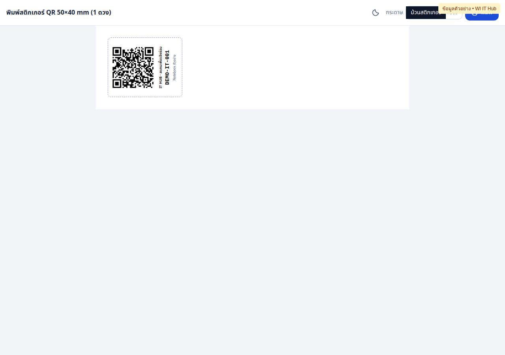

> ผลตรวจรอบนี้ยืนยันการสร้าง PDF ได้ ไม่ได้ยืนยันการพิมพ์จากเครื่องพิมพ์จริง การปรับขนาดของไดรเวอร์และการสแกน QR ผ่าน Wi-Fi โรงงานต้องทดสอบหน้างาน

# 22. จัดการพนักงาน บัญชี และลายเซ็น IT

1. เปิด ข้อมูลพนักงาน เพื่อเพิ่ม/แก้ไขข้อมูลติดต่อ บริษัท สถานะ และสิทธิ์ผู้อนุมัติ
2. ใช้ดึงข้อมูล E-Procurement เมื่อจำเป็น ระบบอ่านข้อมูลต้นทางและอัปเดตทะเบียน IT Hub โดยไม่เขียนข้อมูลกลับต้นทาง
3. บุคคลเดียวที่ข้อมูลตรงกันข้ามบริษัทอาจแสดงรวมเป็นหนึ่งรายการ ตรวจบริษัทที่ครอบคลุมก่อนแก้ข้อมูลร่วมกัน
4. เปิด ผู้ดูแลระบบ เพื่อดูบัญชีและจัดการลายเซ็นของเจ้าหน้าที่ วาดใหม่หรืออัปโหลดรูปตามหน้าจอ จากนั้นบันทึก
5. ใช้บัญชีและลายเซ็นของตนเมื่อลงนามในใบงาน ภาพที่แก้ภายหลังไม่เปลี่ยนหลักฐานที่ลงนามไว้แล้ว

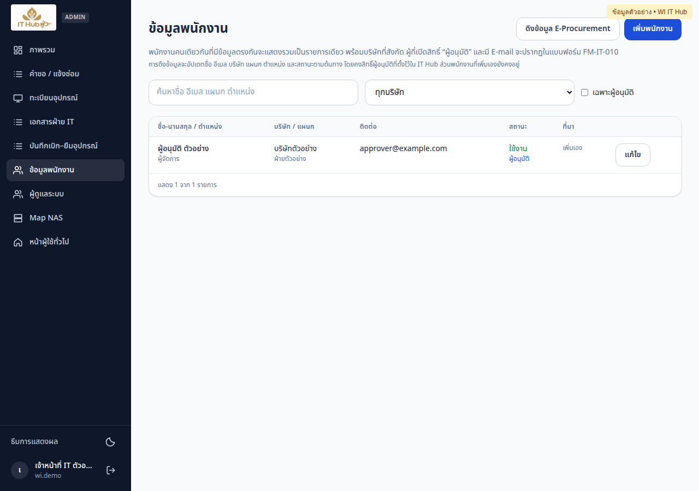

> รายชื่อสาธารณะสำหรับเลือกผู้อนุมัติแสดงข้อมูลจำกัด หากไม่พบชื่อ ให้ตรวจสถานะ อีเมล และสิทธิ์อนุมัติก่อนส่งคำขอ ไม่กำหนดสิทธิ์จากชื่อตำแหน่งเพียงอย่างเดียว

# 23. ตั้งค่าและตรวจ Map NAS

1. Admin เปิด Map NAS ตรวจสถานะการตั้งค่าปัจจุบันก่อนเปลี่ยน
2. กรอกพาธเครือข่ายแบบ UNC เช่น \\192.168.1.10\Documents\IT-DEMO พร้อมชื่อผู้ใช้ รหัสผ่าน และโดเมนถ้ามี ตัวอย่างนี้ไม่ใช่ปลายทางจริง
3. กดทดสอบการเชื่อมต่อเพื่อตรวจบัญชีและอ่านรายการไฟล์ จากนั้นกดบันทึกและเชื่อมต่อเมื่อค่าถูกต้อง การทดสอบอย่างเดียวไม่บันทึกค่า
4. เมื่อแก้โฟลเดอร์โดยยังใช้เครื่อง แชร์ และบัญชีเดิม เว้นรหัสผ่านว่างเพื่อใช้ค่าเดิมได้ หากเปลี่ยนเครื่อง แชร์ หรือบัญชี ให้กรอกรหัสผ่านใหม่
5. ถ้าเชื่อมต่อไม่ผ่าน ค่าที่บันทึกไว้เดิมยังอยู่ ตรวจเครือข่าย สิทธิ์ และพาธก่อนลองใหม่ หากมี Admin แก้พร้อมกันให้โหลดค่าล่าสุด

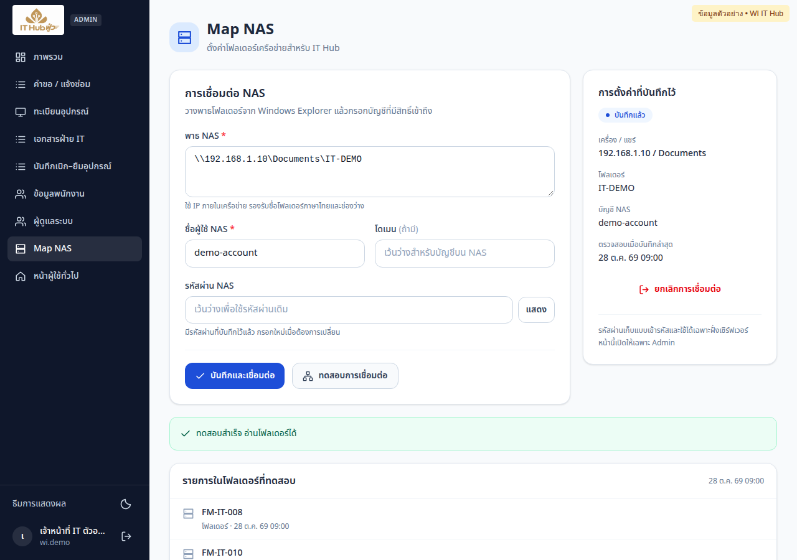

> ใช้ IP ภายในและ SMB พอร์ต 445 รายการแสดงไม่เกิน 100 รายการ ปุ่มยกเลิกการเชื่อมต่อลบการตั้งค่าที่เก็บไว้และไม่ลบไฟล์บน NAS การอ่านรายการสำเร็จยังไม่ยืนยันสิทธิ์เขียน PDF ต้องตรวจผลส่งของใบงานด้วย

# 24. ตรวจการส่ง PDF ไป NAS หลังปิดงาน

1. เมื่อใบงานเป็นเสร็จสิ้น ระบบเข้าคิว snapshot เอกสารและลายเซ็นที่บันทึกไว้ ตัวส่งเบื้องหลังสร้าง PDF และจัดเก็บในโฟลเดอร์แบบฟอร์ม
2. เปิดใบงาน ดูส่วนไฟล์เอกสารบน NAS หรือดูสถานะ NAS ใต้สถานะงานในรายการคำขอ
3. กดตรวจสถานะการส่ง ตรวจข้อความสำเร็จ ชื่อ/พาธไฟล์ และเวลาส่ง เช่น FM-IT-010/FM-IT-010_SV-2610-9001_9001.pdf
4. หากผิดพลาด ให้ตรวจ Map NAS และเครือข่าย ระบบลองใหม่ทุก 5 นาที สูงสุด 8 ครั้ง หลังแก้สาเหตุแล้ว Admin กดส่งเอกสารไป NAS ปัจจุบันอีกครั้งได้
5. หากเปลี่ยนปลายทาง NAS ต้องยืนยันส่งอีกครั้ง คิวเก่าไม่ถูกส่งไปปลายทางใหม่โดยอัตโนมัติ

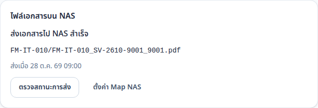

> NAS ขัดข้องไม่เปลี่ยนงานเสร็จสิ้นกลับเป็นงานเปิด การแก้ผลหรือเพิ่มลายเซ็นหลังปิดงานทำให้มีฉบับใหม่และคงฉบับเก่าไว้ คิวรอส่งเก่าอาจถูกข้ามเมื่อมีฉบับใหม่หรือเปิดงานใหม่ ปุ่มตรวจสถานะไม่ได้ดาวน์โหลด PDF; เปิดไฟล์จาก NAS ตามพาธที่แสดงและสิทธิ์ของหน่วยงาน

# 25. แก้เหตุขัดข้องและตรวจงานประจำวัน

| อาการ | วิธีดำเนินการ / หลักฐานที่เก็บ |
| --- | --- |
| ข้อมูลไม่ครบ / ส่งไม่ผ่าน | แก้ช่องที่แสดงข้อผิดพลาด ตรวจเครือข่าย และตรวจว่ามีเลขที่คำขอแล้วหรือยัง |
| ไม่มีผู้อนุมัติในรายการ | ให้ IT ตรวจพนักงาน อีเมล สถานะ และสิทธิ์ ห้ามเลือกผู้อื่นแทนเพียงเพื่อส่งผ่าน |
| ไม่ได้รับอีเมล / ส่งอีเมลไม่สำเร็จ | ตรวจเลขที่ ผู้รับ และอีเมลขยะ ให้ IT ส่งใหม่เมื่อพ้นระยะจำกัดอย่างน้อย 1 นาที ใช้ลิงก์ล่าสุด |
| ลิงก์หมดอายุ / ลงนามแล้ว | ขอ IT ตรวจสถานะและส่งใหม่ถ้าจำเป็น ลิงก์ที่ลงนามแล้วใช้ซ้ำไม่ได้ |
| ปิด SV ไม่ได้ | ตรวจต้นสังกัดอนุมัติ ผลดำเนินการ และลายเซ็นรับรองผลฉบับล่าสุด |
| ไม่พบบันทึกยืม | ตรวจผลอนุมัติ Admin ก่อน คำขอรออนุมัติ/ไม่อนุมัติไม่สร้างบันทึก |
| ค่าถูกแก้จากหน้าจออื่น | โหลดข้อมูลล่าสุด ตรวจความเปลี่ยนแปลง แล้วทำรายการใหม่ ไม่กดบันทึกซ้ำโดยไม่ตรวจ |
| NAS ส่งไม่สำเร็จ | ตรวจข้อความผิดพลาด Map NAS และสิทธิ์เขียน หลังแก้แล้วส่งใหม่จากใบงาน เก็บเลขที่และเวลาที่พบ |
| พิมพ์ผิดขนาด / QR อ่านไม่ได้ | ตรวจขนาดกระดาษ 100% หัว/ท้าย และไดรเวอร์ แล้วพิมพ์ทดสอบและสแกนอีกครั้ง |

รายการตรวจโดย IT: ตรวจคำขอใหม่และรออนุมัติ → งานค้างและผู้รับผิดชอบ → ลายเซ็นรับรองผล → อุปกรณ์ถึงกำหนดคืน → คิว NAS ที่ผิดพลาด → เอกสาร/ลายเซ็นครบ → ออกจากระบบ

ผลตรวจวันที่ 28 ตุลาคม 2569: ชุดทดสอบระบบ 568 ข้อผ่าน และ renderer PDF ครบ 5 ประเภทผ่าน รายละเอียดและข้อจำกัดอยู่ใน SYSTEM-CHECK-2026-10-28.md การรับอีเมลจริง การพิมพ์จริง และการสแกนบน Wi-Fi โรงงานยังต้องยืนยันหน้างาน
